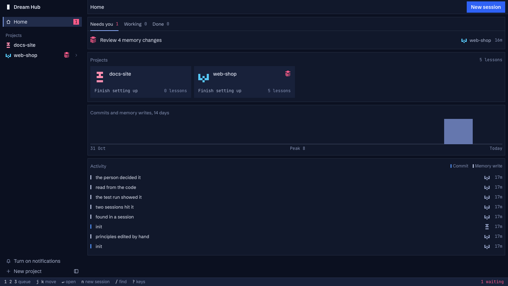
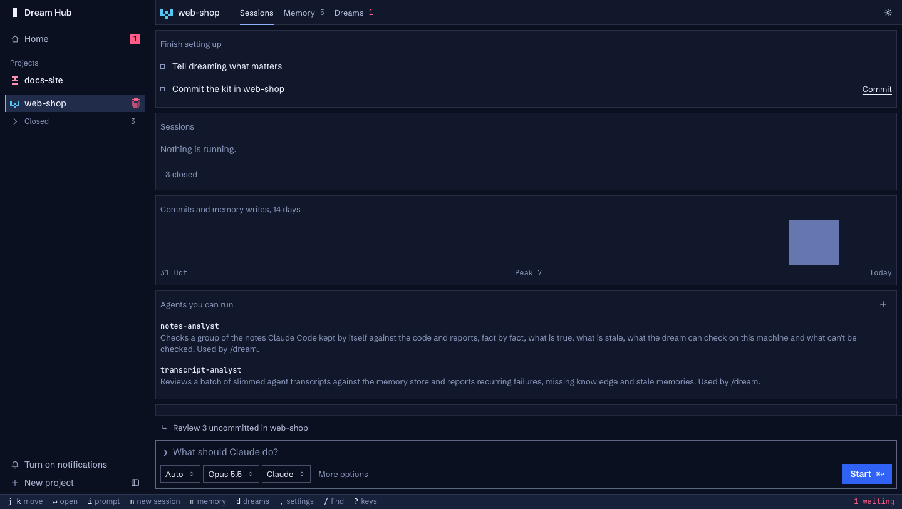
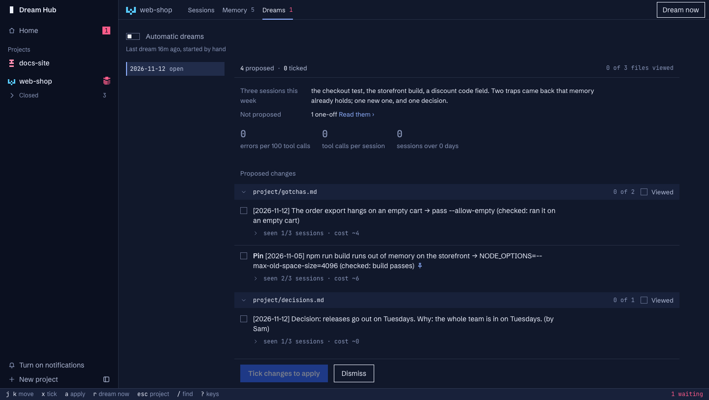
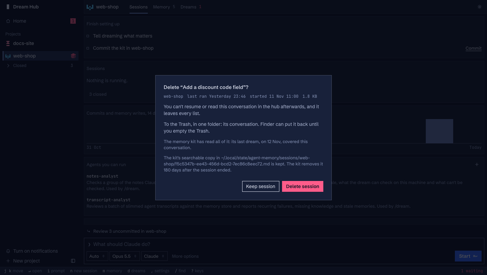
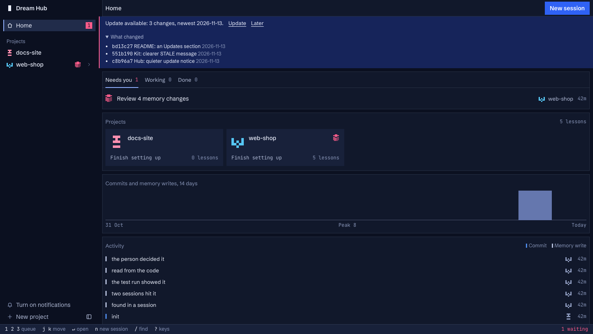

# Dream Hub

Shared memory and a control room for Claude Code agents.

Dream Hub gives the Claude Code agents working on one project a memory they share: plain markdown files in a private
git repository, loaded into every session at start and written through one guarded command. Once a day, if enough has
happened, a "dream" reads the recent sessions and proposes what memory should gain, change or lose; you tick what you
agree with, and only that is applied. A local web page, the hub, runs your Claude Code sessions in browser terminals
and puts proposals, memory and "what needs you" in one place.

By [Christian Almurr](https://github.com/ChristianAlmurr). An independent project, not affiliated with or endorsed by
Anthropic.



It is one person's tool, made public: built for daily use on one Mac, and macOS-only today. It starts real Claude
Code sessions (a dream is one), and those use your Claude plan or API credit like any other session.

## Contents

- [Why](#why)
- [Quick start](#quick-start)
- [A five-minute tour](#a-five-minute-tour)
- [How it works](#how-it-works)
- [Safety model](#safety-model)
- [Configuration](#configuration)
- [Commands](#commands)
- [Requirements and platform support](#requirements-and-platform-support)
- [Updates](#updates)
- [Uninstall](#uninstall)
- [Troubleshooting](#troubleshooting)
- [Roadmap](#roadmap)
- [Credits](#credits) and [Licence](#licence)

## Why

Agents on one project keep rediscovering the same traps: the test that needs an environment variable, the build that
runs out of memory, the decision someone already made and why. Each new session pays for it again. Claude Code's own
notes help one repository at a time, but nothing checks them and nobody approves them.

Dream Hub keeps that knowledge in one place per project, says where every line came from, and puts a person between
what agents notice and what every later agent is told:

- **Memory is files.** A store is a folder of markdown with its own git history: `ORG.md` (your principles),
  `project/gotchas.md`, `decisions.md`, `architecture.md`, scratchpads, an inbox. Agents read it with the tools
  they already have.
- **Writes are checked.** One command writes memory: it refuses a line that looks like a credential or an
  injection, a line too long, or a line that says what another already says, and it commits every write with who
  wrote it and why.
- **Dreams propose, you decide.** The daily dream reads the sessions since the last one and writes a proposal with
  evidence for each item. Nothing reaches memory until you tick it. Your principles are yours alone: no agent and no
  dream can change them.

## Quick start

You need macOS, [Claude Code](https://docs.claude.com/en/docs/claude-code) signed in, `git`, `tmux` and Apple's
Python 3.9 or newer at `/usr/bin/python3` (it comes with `xcode-select --install`). `jj` and Tailscale are optional.

```sh
git clone https://github.com/ChristianAlmurr/dream-hub.git
cd dream-hub
sh install.sh --repo ~/code/my-app
```

`install.sh` checks the prerequisites, then asks before each thing it changes outside the clone:

- it writes the hub's settings to `~/.config/agent-hub/config.json` (mode 600), with a random key;
- it offers to link `~/.local/bin/amk` to the kit's command;
- it offers a launchd job, `ai.agent-hub`, that starts the hub at login (or you start it yourself with
  `/usr/bin/python3 hub/server.py`);
- with `--repo`, it creates a memory store `~/agent-memory/my-app` and attaches your repo to it. In the repo this adds
  `scripts/`, `.claude/` (the `/dream` command, two analyst agents, settings), a protocol block in `CLAUDE.md` and a
  `memory` link that git ignores. It commits nothing in your repo.

The hub lists and creates repos in one projects folder, `~/projects` by default; add `--projects ~/code` if yours live
elsewhere. It never uses `sudo`, and running it again keeps what is already set up. At the end it prints the address
to open once:

```
http://127.0.0.1:8491/?key=<your key>
```

Your browser keeps the key in a cookie, and from then on `http://127.0.0.1:8491` is the hub. Then, once per repo:

1. Start Claude there once and accept the trust dialog: `cd ~/code/my-app && claude`.
2. On the project's Memory page in the hub, write your principles in `ORG.md` and say what matters in this project
   under Steering (the editor lifts the file's lock and puts it back). Until you write them, sessions are told they
   are missing instead of being given the placeholders.
3. Decide whether the kit's files belong in the repo's history. On your own repo, commit `CLAUDE.md`, `scripts/` and
   `.claude/` (the hub's project page has a Commit button). On a shared repo, see [Known limits](#known-limits).

To run dreams on a schedule, turn on **Automatic dreams** on the project's page in the hub (or run
`sh agent-memory-kit/schedule-dream.sh ~/code/my-app --hour 18`). An unattended dream needs a sign-in that lasts: run
`claude setup-token` yourself and save what it prints in `~/.config/agent-memory/oauth-token` with `chmod 600`. Dream
Hub never ships, creates or prints a token.

## A five-minute tour

**Start a session.** Open the project in the hub, type a task in "What should Claude do?", pick a mode and a model,
press Start. The session runs in a tmux terminal in your browser; it keeps running if you close the tab. It starts with
`ORG.md`, Steering and the memory index already loaded, at most 9,500 characters.



**Record a lesson.** When an agent hits a trap and finds the fix, the protocol in `CLAUDE.md` tells it to write one
line, with its evidence:

```sh
python3 scripts/memwrite.py read memory/project/gotchas.md          # prints HASH: <hash>
python3 scripts/memwrite.py write memory/project/gotchas.md --expect <hash> --agent main \
  --why 'two sessions hit it' --append <<'MEMWRITE'
- [2026-11-05] npm run build runs out of memory on the storefront → NODE_OPTIONS=--max-old-space-size=4096 (checked: build passes)
MEMWRITE
```

The write is committed in the store, logged in `CHANGELOG.md`, and the next session's index shows its title. If the file
changed since the agent read it, the write is refused as `STALE` and the agent reads again: several agents can write at
once without overwriting each other.

**The first dream.** Press **Dream now** on the project's Dreams page, or type `/dream` in a Claude session in the repo.
The dream collects the sessions since the last one (slimmed, with anything that looks like a credential removed), has
`transcript-analyst` subagents read them in parallel, checks memory against the code, and writes
`dreams/<date>-proposal.md`. A dream is a real Claude session and uses your plan or credit; how much depends on how
many sessions it reads. The daily check starts one only when one is due (by default after 7 days with at least 3
sessions, or 25 sessions, or 10 new memory lines, or 30 days with at least one session), and a day with nothing due
costs nothing.

**Tick a proposal.** The proposal reads like a code review: changes grouped by file, each with why, how often it was
seen and what it cost, and its evidence behind a chevron. Tick what you agree with.



**Apply.** Press Apply. A session runs `/dream apply`: the kit writes each ticked change as its own checked, committed
write, and records what became of every item. Changes to `ORG.md` or Steering are left for you: the hub gives you the
two commands (lift the lock, run `dream_apply.py --yours`, which shows each change and asks before writing). An item
you left unticked counts as a no; after two noes it is not proposed again.

**Delete a session** you no longer need, from its `⋯` menu. A warning says what will happen before anything does: you
can't resume or read the conversation in the hub afterwards; its transcript (and the hub's copy) moves to one folder in
the Trash, which Finder can put back until you empty it; a running session is stopped first; and whether the last dream
has already read it, so you know whether what it taught would be lost to memory. The kit's searchable archive copy is
kept. Keep is the default.



## How it works

```
  you ── tick, apply, write ORG.md ─────────────┐
                                                 │
  ┌───────────── the hub (localhost web page) ───┼─────────────┐
  │ sessions in tmux · memory · proposals · needs you          │
  └──────┬──────────────────────────────▲────────┼─────────────┘
         │ starts                       │ reads  │
         ▼                              │        ▼
  Claude Code sessions ── memwrite.py ──► store: ~/agent-memory/<project>/  (its own git repo)
  in your repo           (guarded write)   ORG.md · STEERING · INDEX.md · project/*.md · CHANGELOG.md
         ▲                                 │ dreams/<date>-proposal.md
         │ session-start hook loads        │
         └──── ORG.md + Steering + index ◄─┘
                                           ▲
  daily check (launchd) ── run-dream.sh ── a dream: collect sessions → analysts → proposal
```

- **Stores and tiers.** A store serves one project, which can span several repos and their worktrees. `ORG.md` and
  Steering are yours (locked with macOS's `uchg` flag, denied to agents by settings and a Bash hook). `project/*.md`
  is written by agents through `memwrite.py` only. Scratchpads and the inbox are open to agents. `INDEX.md` is
  generated.
- **Loading.** A `SessionStart` and `SubagentStart` hook prints a short note, `ORG.md`, Steering and the index:
  pinned lines first with their cure, then the newest, in at most 9,500 characters. Agents grep for the rest.
- **Guarded writes.** `memwrite.py` takes a hash (or the exact line, for an edit or delete), holds one file lock for
  check, write, log and commit, and refuses credentials, injection phrasing, the store's own `reject.txt` patterns,
  lines over 400 characters and near-duplicates. `memcheck.py` notices anything written around it.
- **Session archive.** Claude Code deletes transcripts after 30 days. The kit keeps a slimmed, scrubbed copy of each
  session in this store's repos for 180 days in `~/.local/state/agent-memory/sessions/`, searchable with
  `python3 scripts/past.py "<words>"`.
- **Dreams.** `run-dream.sh` is the one way a dream starts unattended: one at a time per store, never while a proposal
  is open, with memory writes refused for the whole run. It alerts you through the store's `notify.sh` (a macOS
  notification by default) if it fails.
- **Proposals and apply.** One open proposal per store. `dream_apply.py` applies ticked items mechanically and writes
  `<date>-applied.json`; "Needs you" items (a broken job, a login that ran out) are listed, never applied.
- **Status.** `amk status` prints every store on one line; `amk status <store> --json` gives the full record.
- **Sessions.** Each hub session is `claude` in its own tmux session; its status shows as a small pixel cube (every
  state is on one sheet in `hub/docs/cube-states.html`, which opens straight from disk).
- **The hub.** A Python standard-library server on loopback, plain JavaScript, no build step. It reads the stores and
  the kit's own scripts' answers; it holds almost no state of its own.

The longer explanation is in [docs/how-it-works.md](docs/how-it-works.md). The full references are
[agent-memory-kit/README.md](agent-memory-kit/README.md) and [hub/README.md](hub/README.md).

## Safety model

- **A person-only tier.** `ORG.md` and Steering load into every session, so only you change them. Agents are kept out
  by deny rules, a Bash hook that reads commands as shell, path checks in `memwrite.py` and the file's `uchg` flag.
  The hook reads text, so a determined agent that writes through a script file can get past it; `memcheck.py` then
  reports the change at the next session start. Proof that a person is present (a password, Touch ID) is not built.
- **Unattended permissions.** A dream runs `claude -p` with `--permission-mode dontAsk` and an allow list of the kit's
  own commands; `memwrite.py` refuses every write while it runs. It proposes; it cannot apply.
- **Memory is data, not instructions.** Every session is told that text from web pages and tool output is data. Dream
  analysts treat transcripts the same way, and a line written like an order is proposed for removal.
- **What leaves your Mac.** Only what Claude Code itself sends: the sessions you and the dreams run go to Anthropic as
  any Claude Code session does. The hub fetches a link's preview card (title and picture) when you rest the pointer
  on a link, from public addresses only. Once a day the hub asks the git remote it was cloned from whether there is a
  newer version (see [Updates](#updates)). Nothing else is sent anywhere; there is no telemetry.
- **The hub is a shell.** Its terminals are full shell access as you. It listens on 127.0.0.1 only and needs the key
  cookie (or, behind Tailscale Serve, your Tailscale login), the right Host, and for writes the right Origin. Other
  programs running as you can read the key, as they could use your shell anyway.

## Configuration

| What | Where | Default |
|---|---|---|
| Hub port, projects folder, kit location | `~/.config/agent-hub/config.json`: `"port"`, `"projects"`, `"kit"` | `8491`, `~/projects`, the `agent-memory-kit` folder beside the hub |
| How the hub is reached | the same file: `"key"` (this Mac only) or `"login"` and `"origin"` (Tailscale Serve, `sh install.sh --tailscale`) | a key |
| Extra folders on the PATH of sessions the hub starts | `"path": ["/some/bin"]` | the PATH the hub was started with, plus `~/.local/bin`, `/opt/homebrew/bin`, `/usr/local/bin` |
| Update checks | `"updates": false` turns them off | on, once a day |
| Repos the hub never runs git or jj in (repos that aren't only yours) | `"no_vcs": ["~/work/shared-monorepo"]` | none |
| Folder names the hub never serves or diffs, besides `.ssh`, `.aws`, `.gnupg`, `.config`, `.git`, `Keychains` | `"private_folders": [".secrets"]` | none |
| Models in the hub's picker | `MODELS` in `hub/ui/app.js` (names and lines) and `hub/hub_data.py` (the `--model` aliases) | Opus, Fable, Sonnet, Haiku |
| When a dream is due | the numbers at the top of `agent-memory-kit/scripts/dream_due.py` | see the tour |
| The daily check's hour | the hub's Automatic dreams switch, or `schedule-dream.sh <repo> --hour N` | a free evening hour |
| Where a dream may check facts about this Mac | `~/.config/agent-memory/places`, one folder per line | `~/projects`, `~/tools` |
| Alerts | `~/agent-memory/<store>/notify.sh <title> <body>` | a macOS notification |
| What a store refuses | `~/agent-memory/<store>/reject.txt`, one regular expression per line | nothing extra |
| A token for unattended dreams | `~/.config/agent-memory/oauth-token` (yours to create) | none |

Restart the hub after changing its config: `launchctl kickstart -k gui/$(id -u)/ai.agent-hub`, or stop and start
`hub/server.py`.

## Commands

The kit's commands, run from the root of your clone (or anywhere, with the whole path):

| Command | What it does |
|---|---|
| `sh agent-memory-kit/install-store.sh <store> <repo> [repo …]` | create a store (or add repos to one) and attach the repos |
| `sh agent-memory-kit/sync-kit.sh [store …]` | copy a changed kit into every attached repo, keeping each repo's Steering and settings |
| `sh agent-memory-kit/schedule-dream.sh <repo> [--hour N \| --remove]` | turn the daily dream check on or off (one launchd job per store, `ai.agent-memory.dream.<store>`) |
| `sh agent-memory-kit/run-dream.sh <repo> [--if-due]` | run one unattended dream now (or only if one is due) |
| `sh agent-memory-kit/retire-auto-memory.sh <store> [--undo]` | turn Claude Code's own auto memory off in the store's repos, once a dream has carried its notes over |
| `sh agent-memory-kit/link-worktrees.sh <store> <repo>` | link `memory/` into worktrees that already exist |
| `agent-memory-kit/bin/amk status [<store>] [--json]` | every store on one line, or one in full |
| `agent-memory-kit/bin/amk help` | all verbs: `read`, `write`, `edit`, `delete`, `undo`, `past`, `check`, `due`, `proposal`, `apply`, `where`, `attach`, `detach`, … |

In a repo with the kit, agents and you use `python3 scripts/<name>.py`: `memwrite.py` (read, write, edit, delete,
undo), `past.py` (search earlier sessions), `memcheck.py` (is the store intact), `dream_due.py` (is a dream due),
`dream_proposal.py` (the open proposal; `dismiss`, `withdraw`, `forget`, `done` are yours), `dream_apply.py`
(`--dry-run`, `--yours`), `own_notes.py` (Claude Code's own notes for these repos). In Claude Code: `/dream`,
`/dream 14`, `/dream apply`.

Tests: `sh agent-memory-kit/tests/test-kit.sh` runs every rule offline in a throwaway HOME (about seven minutes, no
cost). `agent-memory-kit/tests/test-live.sh` and the hub's `tests/test_hub.py`, `lifecycle_check.py`,
`status_check.py` and `browser_check.py` start real Claude sessions; see [hub/README.md](hub/README.md#tests).

## Requirements and platform support

- **macOS**, with Apple's Python 3.9 or newer at `/usr/bin/python3`. Built and tested on one Mac with Python 3.9.6.
  Standard library only: nothing to `pip install`.
- **Claude Code**, signed in. Sessions started by the hub use `--remote-control` so they can be followed from the
  Claude app; that depends on your account having Remote Control.
- **git**, **tmux** 3.2 or newer. Optional: **jj** (for jj repositories), **Tailscale** (to reach the hub from your
  phone or another computer), **Google Chrome** (only for the hub's browser test).

What is macOS-only: the `uchg` flag that locks `ORG.md` and Steering (`chflags`), launchd for the daily check and the
hub's job, `sips` for image thumbnails, `osascript` for the default alert, and some `lsof` output the hub parses. A
Linux port would need: `chattr +i` (which needs root) or another lock for the person's tier, systemd user timers in
place of launchd, another thumbnailer (or none), `notify-send` for alerts, and checking the `lsof`/`ps` parsing. None
of that is done.

## Updates

Once a day, when it starts, and when you press **Check for updates** in the `?` sheet, the hub asks the repository it
was cloned from (`git ls-remote` on your clone's `origin`) whether its default branch has moved. If it has, the hub
fetches that one branch to count the new commits and shows a quiet notice above the page: "Update available: N
changes", with each commit's subject and date, and on GitHub a link to the commits page. **Later** hides it until
something newer arrives. The `?` sheet shows the commit and date you run.



Nothing is installed by itself: running new code from the internet without your click would be a risk. Press
**Update** in the notice, or run:

```sh
sh update.sh
```

It refuses, changing nothing, when your clone has uncommitted changes, isn't on its default branch, has commits of its
own, or can't reach the remote. Otherwise it moves the clone forward (`git merge --ff-only`), copies the kit into the
repos of every store when the kit changed (skipping a store whose dream is in progress, and saying so), lists the repos
whose kit files now differ so you can commit them yourself, and restarts the hub's launchd job if you installed it
(otherwise it tells you to restart the hub). Running sessions keep running: their terminals live in tmux. Run it again
and it says the hub is up to date.

What the check sends: a normal git request to your clone's `origin`, which reveals your IP address and that this copy
asked, as any `git fetch` does. Nothing about you or your projects. Turn it off with `"updates": false` in
`~/.config/agent-hub/config.json`. It also stays quiet when the hub doesn't run from a git clone, the clone has no
`origin`, or the remote can't be reached. Unattended dreams never check for updates.

## Uninstall

```sh
sh uninstall.sh
```

It asks before each step: the hub's launchd job, its tmux terminals, the daily dream jobs, the `amk` link, the
Tailscale Serve entry, the hub's settings and state, the kit's state and session archive. It keeps your memory stores
(`~/agent-memory`) and the kit's files in your repos, and prints how to remove those by hand.

## Troubleshooting

- **The hub says "Not yours."** Open the `?key=` address from `install.sh` once in this browser, or run
  `sh install.sh --new-key` for a new one. The address must be exactly the `origin` in the config (`127.0.0.1`, not
  `localhost`).
- **The hub doesn't start.** Read `~/.local/state/agent-hub/server.log`. A port in use: `sh install.sh --port 8500`.
- **A session shows "needs you" right after it starts.** Claude Code is asking you to trust the folder. Answer it in
  the terminal.
- **Sessions don't get memory.** Run `/hooks` and `/permissions` in Claude Code in that repo to see that the kit's
  settings loaded, and `python3 scripts/memcheck.py` to check the store.
- **"Dream failed" alerts.** Usually the sign-in ran out: see the token step in the quick start. The dream's log is
  `~/.local/state/agent-memory/dream-<store>.log`.
- **`amk` says the Python on record has changed.** Run `amk interpreter record` after updating Xcode or Python.
- **`memcheck.py` or the hub says `ORG.md is not locked`.** See what changed with
  `git -C ~/agent-memory/<store> diff ORG.md`, then lock it again: `chflags uchg ~/agent-memory/<store>/ORG.md`.

## Roadmap

The kit was built as files copied into every repo. The plan, in
[agent-memory-kit/docs/one-kit-design.md](agent-memory-kit/docs/one-kit-design.md), is "one kit, nothing in repos":
the kit installed once as a Claude Code plugin, each repo tied to its store by a git config key, nothing committed in
any repo.

| Step | | State |
|---|---|---|
| 1 | `bin/amk`, the store resolver, `amk status` | done |
| 2 | The hub reads `amk status` instead of its own copies of the kit's rules | not done |
| 3 | Scripts stop treating their own folder as a repo; Steering in the store (`STEERING.md`); dreams for a repo tied by its key alone | done |
| 4 | Plugin packaging and `amk install` (hooks, `/dream` and analysts from the plugin) | not done |
| 5–7 | Moving stores to the key, one at a time; cleaning the kit out of repos | not done |
| 8 | One hourly scheduler in place of one launchd job per store | not done |
| 9 | A machine-wide tier of memory shared by every store | not done |
| 10 | Removing the links, hooks and copy scripts | not done |

Until step 4, a repo tied by its key alone has no memory at session start and no `/dream` command; attach repos with
`install-store.sh` as the quick start does. Also not built: a Linux port, a real proof of presence for the person's
tier, and stores shared between machines (the lock is a local file lock).

### Known limits

- The kit's files live in each repo (until step 4). On a repo that isn't only yours, keep them untracked: the
  installer already keeps `memory/` and local settings out of git, and you can add the rest to `.git/info/exclude`.
  List such repos under `"no_vcs"` so the hub never commits there.
- One Mac. Agents on several machines would need a shared store with server-side compare-and-swap.
- The guard reads shell text; it cannot see inside a script file. Claude Code's sandbox is the way to prevent rather
  than detect such writes.
- Dreams cost usage. The due rule keeps them rare; raise its numbers if they find little.

More, with the reasons, in [agent-memory-kit/README.md](agent-memory-kit/README.md#known-limits-honest).

## Credits

By [Christian Almurr](https://github.com/ChristianAlmurr).

Inspired by Anthropic's "The components of agent memory". Dream Hub is an independent project, not affiliated with
or endorsed by Anthropic.

The hub bundles [xterm.js](https://github.com/xtermjs/xterm.js) and its fit addon (MIT) and the fonts Schibsted
Grotesk and JetBrains Mono (SIL Open Font License 1.1); their licences are in `hub/ui/vendor/` and
`hub/ui/fonts/OFL.txt`.

## Licence

[MIT](LICENSE). Third-party files keep their own licences: see [THIRD_PARTY_NOTICES.md](THIRD_PARTY_NOTICES.md).
